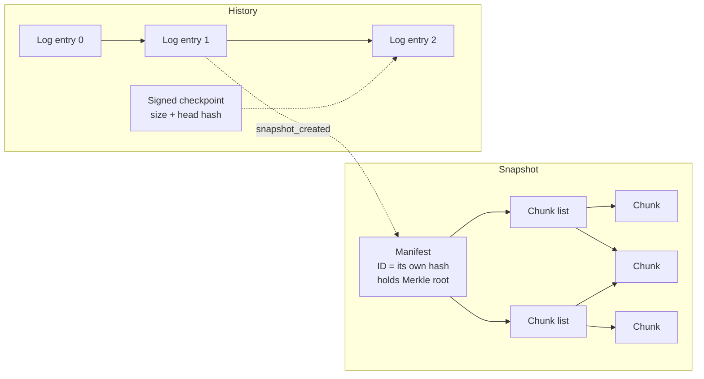

# Provable Backup Engine

**Snapshots you can prove, with a history you can audit.**

Attackers who plan to encrypt production usually go after the backups first,
by deleting snapshots, shortening retention, or quietly editing what the
backup system says happened. Most backup tools tell you the data is
immutable. This one also lets you **prove** what happened to it, and lets you
check that proof with tools that don't depend on the backup host.

It's a content-addressed, deduplicating, crash-safe snapshot engine written
from scratch in C++17. It puts most of its effort into two things:

- **A tamper-evident operations log.** Every create and delete is recorded in
  a hash chain. Ed25519-signed checkpoints of that chain, kept off the host,
  make rewriting or truncating the log detectable.
- **Merkle proofs over snapshots.** An RFC 6962 (Certificate Transparency)
  Merkle tree over every chunk lets you check a whole snapshot without
  restoring it, and produce small proofs that a chunk belongs to it.

> **Status:** research project, not production backup software. See
> [What it guarantees](#what-it-guarantees-and-what-it-doesnt) and
> [Known limitations](#known-limitations) before trusting it with anything.

---

## See it catch tampering

Everything below runs locally in about a minute. The output shown is real.

```sh
cmake -S . -B build && cmake --build build
B=./build/backup_engine

$B init repo
mkdir -p src && echo "quarterly numbers" > src/report.txt
$B backup repo src
$B backup repo src            # second snapshot: everything deduplicated

# Sign a checkpoint of the log. In real use, the key and the signed
# checkpoint live on a different machine from the repo.
$B keygen signer.key signer.pub
$B head repo > statement.txt
$B sign-checkpoint signer.key statement.txt > checkpoint.txt
```

**Attack 1: delete the newest log entry.** The shorter chain is still
internally consistent, so the hash chain alone can't tell. The signed
checkpoint can:

```console
$ chmod u+w repo/operations.log && sed -i.bak '$d' repo/operations.log
$ $B verify-log repo
OK (1 entries)
$ $B verify-checkpoint repo checkpoint.txt signer.pub
FAILED: log has 1 entries but the checkpoint covers 2: entries were removed (truncated)
```

**Attack 2: edit an old entry in place.** The hash chain catches it, and
names the entry:

```console
$ mv repo/operations.log.bak repo/operations.log
$ sed -i.bak '1s/snapshot_created/snapshot_deleted/' repo/operations.log
$ $B verify-log repo
FAILED at seq 0: entry_hash does not match a recomputed hash of the entry's own fields
```

**Check a snapshot without restoring it,** and produce a proof for one chunk.
The output below is from a larger, 11-chunk snapshot. Chunk IDs are listed
in each file's chunk list, which you can read with `get`.

```console
$ $B verify-snapshot repo <snapshot-id>
OK (11 chunks checked)
$ $B prove repo <snapshot-id> <chunk-id> proof.txt
wrote proof to proof.txt (4 path elements)
$ $B verify-proof proof.txt           # needs no repo access
OK (chunk sha256:92b2… included in root sha256:6560…)
```

---

## What it guarantees, and what it doesn't

| Event | Outcome |
|---|---|
| Bit rot or edits to a stored object | **Detected** on every read, and by `verify-snapshot`. Not repaired. |
| An old log entry edited in place | **Detected** by `verify-log`, which names the first bad entry. |
| Newest log entries deleted (truncation) | **Detected** by `verify-checkpoint`, for entries covered by a signed checkpoint. Entries after the latest checkpoint are covered only by the hash chain. |
| Whole log rebuilt with fresh hashes | **Detected** by `verify-checkpoint`, as long as the checkpoint and public key are stored off the host. |
| Objects or the whole repo deleted | **Detected** (reads fail), **not prevented**. Prevention needs storage the attacker can't control, such as S3 Object Lock ([roadmap](ROADMAP.md)). |
| A forged "snapshot deleted" entry | **Detected** by `verify-log`, but restore refuses that snapshot until someone runs it. |
| Different auditors shown different logs, each with a valid checkpoint | **Not covered.** Needs a public transparency log ([roadmap](ROADMAP.md)). |
| Signing key stolen | **Not covered.** Keep the key off the repo host. |
| Someone reads your data | **Not covered.** No encryption yet. |

In short, this project **detects** tampering. It doesn't **prevent** it. Read-only
file permissions are used as a speed bump against accidents, not as a
security boundary.

---

## How it works



**Content-addressed object store.** Every object (chunk, chunk list or
manifest) is stored under the SHA-256 hash of its own bytes. Identical
content is stored once, and every read re-hashes the data and rejects it if
the hash doesn't match.

**Crash-safe writes.** Each object is written to a temp file, fsynced,
renamed into place, and then its directory is fsynced, so a half-written
object is never visible. A snapshot only exists once its log entry is
durable. On macOS, `F_FULLFSYNC` barriers around that entry make sure
everything it refers to reaches the disk first.

**Content-defined chunking.** Files are split with a FastCDC-style Gear
hash (2 KB minimum, 8 KB average, 32 KB maximum). Boundaries depend on
content, not offsets, so inserting bytes only changes nearby chunks.
Inserting 28 bytes into a 200 KB file re-stores 1 of 21 chunks.

**Snapshots.** A manifest lists every file and directory with its mode,
size and chunk list. The manifest's own hash is the snapshot ID, so the ID
commits to the entire tree.

**Operations log.** Each entry's hash covers its fields and the previous
entry's hash. `verify-log` re-walks the chain and reports the first entry
that breaks it. Deleting a snapshot appends a tombstone entry. It never
removes data, because chunks may be shared with other snapshots.

**Signed checkpoints.** `head` prints a statement of the log's size and head
hash. Signing it with an Ed25519 key kept on another machine produces a
checkpoint, the same shape as a Certificate Transparency signed tree head.
`verify-checkpoint` checks that the log still contains that exact head at
that position. New entries after the checkpoint are fine, since logs only
grow.

**Merkle tree.** Every snapshot's chunk hashes form an RFC 6962 Merkle tree
(leaf and internal-node hashes are domain-separated with `0x00` and `0x01`
prefixes), and the root is stored in the manifest. `verify-snapshot`
recomputes it without writing any files. `prove` produces a logarithmic-size
proof for one chunk.

> **Read this before relying on proofs:** `verify-proof` checks a proof
> against the root written inside the proof file. On its own, that only
> shows the proof is internally consistent. A proof means something once you
> compare its root with the `merkle_root` of a snapshot manifest you already
> trust. File-level proof bundles that chain all the way up to a signed
> checkpoint are [next on the roadmap](ROADMAP.md).

---

## Design decisions

- **SHA-256, not BLAKE3.** It's universally recognized, and anyone can check
  it with `shasum -a 256`. Each digest records its algorithm, so adding
  another later doesn't break existing data.
- **Gear hashing, not Rabin.** It's cheaper per byte, and FastCDC-style
  normalization keeps chunk sizes close to the average. The table of random
  values the hash uses is fixed forever, because changing it would silently
  break dedup.
- **Small chunks on purpose.** Production tools use roughly 1 MB chunks. At
  8 KB, dedup is visible at demo scale.
- **Verification is an explicit audit step, not a gate on restore.**
  Re-checking a long chain on every read doesn't scale, and one corrupted old
  entry shouldn't lock you out of every newer snapshot. It's the same idea as
  `git fsck`.
- **Tombstones, not deletion.** Deduplicated chunks are shared between
  snapshots, so freeing space needs a reachability pass. Restore still
  refuses a tombstoned snapshot.
- **Standard constructions, not custom ones.** RFC 6962 for the tree, RFC 8032
  Ed25519 for signatures, and canonical text formats, so a signature covers
  exactly one possible encoding.
- **Strong barriers only at the commit point.** `F_FULLFSYNC` costs
  milliseconds, so it's used once before and once after the log append, not
  per chunk.
- **Minimal dependencies.** SHA-256 and [Monocypher](https://monocypher.org)
  are vendored in `third_party/`. GoogleTest is fetched only for the test
  suite.

---

## How correctness is checked

There are 126 unit tests, written with GoogleTest. Crash safety is tested
deterministically, not with random kills. Snapshot creation calls a test
hook after every durable write. For each of those points, the test forks a
child process, which kills itself with `SIGKILL` exactly there. The parent
then checks that the repo reopens, the log verifies, and every snapshot it
lists restores completely.

```sh
ctest --test-dir build --output-on-failure
```

---

## Command reference

| Command | Purpose |
|---|---|
| `init <repo>` | Create a repository |
| `backup <repo> <dir>` | Snapshot a directory; prints the snapshot ID and the log head |
| `restore <repo> <snapshot> <dest>` | Restore a snapshot |
| `snapshots <repo>` | List live snapshots |
| `delete <repo> <snapshot>` | Tombstone a snapshot |
| `verify-log <repo>` | Check the whole operations log chain |
| `head <repo>` | Print a checkpoint statement for the current log |
| `keygen <secret> <public>` | Generate an Ed25519 key pair (no repo needed) |
| `sign-checkpoint <secret> <statement>` | Sign a statement (no repo needed) |
| `verify-checkpoint <repo> <checkpoint> <public>` | Check the log against a signed checkpoint |
| `verify-snapshot <repo> <snapshot>` | Re-hash every chunk and recompute the Merkle root |
| `prove <repo> <snapshot> <chunk> <out>` | Write an inclusion proof for one chunk |
| `verify-proof <proof>` | Check a proof file (no repo needed) |
| `put` / `get` / `verify` | Low-level object store access |

Build requirements: CMake 3.20 or newer, a C++17 compiler, and macOS or
Linux.

---

## Known limitations

- Detection, not prevention. Read-only permissions don't stop the file's
  owner or root.
- Inclusion proofs are per chunk, and they aren't yet tied to a signed
  checkpoint (see the note above).
- No garbage collection: deleting a snapshot doesn't free space.
- No encryption and no remote storage. It runs on a single machine.
- Regular files and directories only. Symlinks and special files are
  rejected, not skipped.
- Whole files are held in memory during backup and restore.
- Manifest entries aren't sorted, so the same tree can get different snapshot
  IDs on different filesystems.
- There's no lock on the operations log, so two concurrent backups can
  collide. `verify-log` would catch it.

The full list, and the plan for each item, is in [ROADMAP.md](ROADMAP.md).

---

## License

No license has been chosen yet. Until one is, all rights are reserved.

Third-party code keeps its own license: [Monocypher](https://monocypher.org)
(CC0 or BSD-2-Clause), and a public-domain SHA-256 implementation
(`third_party/sha256`).
